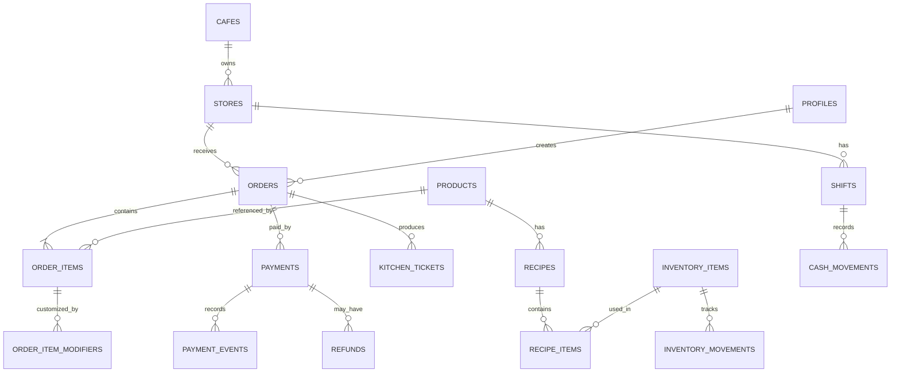

# Cafe POS Blueprint

## Spesifikasi Produk, UI/UX, Backend, Database, QRIS, dan Aturan untuk AI Coding Agent

> Dokumen ini adalah sumber acuan utama untuk membangun aplikasi POS
> kafe berbasis **Next.js App Router, React, TypeScript, dan Supabase**.
> AI coding agent harus membaca dokumen ini sebelum mengubah atau
> membuat kode. Jika ada keputusan yang belum ditentukan, pilih solusi
> sederhana yang aman dan tandai asumsi tersebut, jangan mengarang
> kebutuhan bisnis yang besar.

------------------------------------------------------------------------

## 1. Tujuan Produk

Bangun sistem operasional kafe yang memiliki beberapa antarmuka berbeda
tetapi menggunakan backend dan database yang sama:

1. **POS Kasir** untuk membuat pesanan dan menyelesaikan pembayaran
   secepat mungkin.
2. **Admin Dashboard** untuk mengelola menu, staf, stok, transaksi, dan
   laporan.
3. **Kitchen Display System (KDS)** untuk barista atau staf dapur
   memproses antrean pesanan.
4. **QR Self-Ordering** sebagai fitur lanjutan, agar pelanggan bisa
   memesan lewat ponsel dengan memindai QR meja.

Jangan memperlakukan aplikasi ini sebagai satu dashboard generik. Setiap
antarmuka memiliki tujuan, prioritas informasi, navigasi, dan layout
yang berbeda.

### Prinsip utama

- Cepat digunakan saat jam ramai.
- Antarmuka kasir ramah layar sentuh.
- Harga, total, status order, dan status pembayaran mudah dipahami.
- UI konsisten dan profesional, bukan dashboard admin generik yang
  hanya berisi kartu statistik.
- Backend memvalidasi harga, izin, transaksi, dan status pembayaran.
  Frontend tidak boleh menjadi sumber kebenaran untuk hal-hal
  tersebut.
- Database memakai migration yang masuk version control.
- Aman untuk penggunaan multi-user dan dapat dikembangkan ke
  multi-cabang.
- Jangan menambahkan fitur yang tidak diperlukan hanya untuk membuat
  aplikasi terlihat kompleks.

------------------------------------------------------------------------

## 2. Stack Teknologi

### Wajib

- Next.js App Router
- React
- TypeScript
- Supabase PostgreSQL
- Supabase Auth
- Row Level Security (RLS)
- Supabase CLI migrations
- Tailwind CSS
- shadcn/ui untuk komponen dasar yang dapat dikustomisasi
- Zod untuk validasi skema
- React Hook Form untuk formulir yang kompleks
- Vitest untuk unit/integration tests
- Playwright untuk alur end-to-end penting

### Integrasi

- Payment gateway Indonesia untuk QRIS, misalnya Midtrans atau Xendit.
  Pilih satu terlebih dahulu setelah memeriksa kebutuhan merchant,
  biaya, dokumentasi terbaru, dan dukungan akun.
- Supabase Realtime untuk update status order/KDS bila sesuai.
- Printer thermal melalui pendekatan yang kompatibel dengan perangkat
  dan browser target. Jangan mengasumsikan semua printer dapat dicetak
  langsung dari browser tanpa konfigurasi atau bridge.
- Offline mode bukan fitur otomatis dari Supabase. Implementasikan
  secara terpisah jika memang menjadi kebutuhan, dengan antrean lokal
  dan strategi sinkronisasi yang jelas.

### Jangan dilakukan tanpa alasan kuat

- Jangan membuat microservices untuk versi awal.
- Jangan menambahkan backend Go/Laravel/Express terpisah hanya karena
  POS membutuhkan backend. Next.js server-side handlers dan Supabase
  sudah cukup untuk versi awal.
- Jangan menyimpan service-role key atau payment secret di
  client/browser.
- Jangan menaruh semua business logic di React components.
- Jangan mengandalkan data dari frontend sebagai bukti bahwa
  pembayaran berhasil.

------------------------------------------------------------------------

## 3. Referensi Produk Nyata

Gunakan referensi berikut untuk mempelajari pola interaksi dan fitur.
**Jangan menyalin branding, aset, atau tampilan secara mentah.** Buat
identitas visual sendiri.

### A. Square for Restaurants

- Referensi utama: layar input order, menu berbentuk grid, kategori,
  keranjang, modifier, dan checkout.
- Pelajari bagaimana kasir memilih produk dan memeriksa order tanpa
  berpindah terlalu banyak halaman.
- Website: https://squareup.com/ca/en/point-of-sale/restaurants/full-service

### B. Loyverse POS

- Referensi utama: POS untuk usaha kecil/kafe, varian dan modifier
  produk, open tickets, cash management, inventory, employee
  permissions, sales reports, dan KDS.
- Sangat relevan untuk memetakan kebutuhan operasional kafe skala
  kecil hingga menengah.
- Fitur dalam Bahasa Indonesia: https://loyverse.com/id/features
- Back Office / laporan: https://loyverse.com/en-us/back-office

### C. Toast POS

- Referensi utama: alur order restoran, order yang masih terbuka,
  dine-in/takeaway, dan perpindahan order ke dapur/barista.
- Pelajari alur operasionalnya, bukan menyalin UI atau asumsi bahwa
  semua fiturnya tersedia di Indonesia.
- Website: https://pos.toasttab.com/restaurant-pos

### Aturan penggunaan referensi

- Square: acuan interaksi kasir dan layout order-entry.
- Loyverse: acuan cakupan fitur POS, stok, shift, dan laporan.
- Toast: acuan alur pesanan dan produksi dapur.
- Tidak ada satu produk yang harus ditiru sepenuhnya.
- Pastikan desain akhir konsisten sebagai satu produk sendiri.

------------------------------------------------------------------------

## 4. Arah Visual dan Design System

### Arah desain

**Modern café, warm minimal, operational-first.**

Nuansa visual:
- Hijau hutan gelap atau charcoal untuk navigasi dan CTA utama.
- Putih hangat/cream dan abu-abu lembut untuk permukaan.
- Warna status yang jelas untuk paid, pending, failed, cancelled, ready, dan completed.
- Foto produk yang konsisten untuk menu kasir.
- Tipografi yang mudah dibaca dari jarak kerja kasir.
- Spasi yang rapi, hierarchy visual kuat, dan sedikit dekorasi yang tidak membantu pekerjaan.

Contoh token warna awal, bebas disesuaikan setelah diuji kontras:
- `--color-brand: #173A2E`
- `--color-brand-strong: #102A22`
- `--color-accent: #D8E9C5`
- `--color-canvas: #F7F6F1`
- `--color-surface: #FFFFFF`
- `--color-text: #1E2924`
- `--color-muted: #68756E`
- `--color-border: #E2E6E1`
- Status sukses: hijau dengan kontras memadai.
- Status pending: amber.
- Status gagal/error: merah.
- Status info: biru atau netral.

Jangan mengandalkan warna saja untuk menjelaskan status. Tambahkan label teks atau ikon.

### Prinsip responsif

- POS harus nyaman di desktop dan tablet landscape.
- Admin dashboard harus responsif, tetapi tabel kompleks boleh
  memiliki scroll horizontal yang terkontrol.
- KDS harus bisa dibaca dari jarak beberapa meter, dengan kartu order
  besar dan status jelas.
- Hindari layout mobile-first yang membuat area kasir desktop terlalu
  sempit.
- Jangan mengecilkan tombol transaksi utama menjadi tombol kecil.

### Anti-pattern yang harus dihindari

- Semua halaman memiliki layout, sidebar, dan kartu statistik yang sama.
- Gradient berlebihan, glassmorphism tanpa alasan, animasi dekoratif berlebihan.
- Terlalu banyak warna aksen.
- Tombol checkout sulit ditemukan.
- Total belanja atau status pembayaran tersembunyi.
- Data dummy tetap muncul di production.
- Tombol yang terlihat aktif tetapi belum berfungsi.
- Membuat seluruh interface hanya berupa tabel.
- Menggunakan gambar produk yang tidak konsisten atau sekadar
  placeholder tanpa label saat development.

------------------------------------------------------------------------

## 5. Antarmuka 1: POS Kasir

### Tujuan

Kasir dapat membuat pesanan, menyesuaikan item, dan menerima pembayaran
dengan langkah sesedikit mungkin serta tetap memahami status order.

### Layout desktop/tablet yang disarankan

- Header: nama outlet, status koneksi, kasir aktif, shift, dan akses
  ke order tertunda.
- Area kiri/tengah: pencarian produk, filter kategori, dan grid produk.
- Area kanan: keranjang yang selalu terlihat.
- Bagian bawah keranjang: subtotal, diskon/biaya yang berlaku, total,
  dan tombol checkout.
- Checkout membuka panel/modal yang jelas untuk memilih metode pembayaran.
- Tidak menampilkan grafik omzet besar pada layar utama kasir.

### Contoh wireframe konseptual

```text
┌────────────────────────────────────────────────────────────────────┐
│ KOPI POS   Outlet: Kemang   Shift: Pagi   Kasir: Dita   [Orders]   │
├────────────────────────────────────────┬───────────────────────────┤
│ [Cari menu...]                         │ PESANAN #A-0102            │
│ [Semua] [Coffee] [Non-Coffee] [Food]   │                           │
│                                        │ Iced Latte     Rp25.000   │
│ ┌─────────────┐ ┌─────────────┐        │   Less sugar  x1          │
│ │ Foto produk │ │ Foto produk │        │ Matcha        Rp28.000   │
│ │ Iced Latte  │ │ Iced Matcha │        │   Regular     x1          │
│ │ Rp25.000    │ │ Rp28.000    │        │                           │
│ │ [+ Tambah]  │ │ [+ Tambah]  │        │ Subtotal       Rp53.000  │
│ └─────────────┘ └─────────────┘        │ Diskon         Rp0       │
│                                        │ TOTAL          Rp53.000  │
│                                        │ [Lanjut Bayar]            │
└────────────────────────────────────────┴───────────────────────────┘
```

Harga pada wireframe hanya contoh, bukan harga bisnis yang wajib dipakai.

### Alur tambah produk

1. Kasir mencari atau memilih produk.
2. Jika produk memiliki ukuran/modifier wajib, tampilkan dialog pilihan.
3. Validasi jumlah pilihan, opsi yang wajib, dan opsi yang saling eksklusif.
4. Kasir menambahkan produk ke keranjang.
5. Keranjang menampilkan nama, varian, modifier, jumlah, harga, dan
   subtotal per item.
6. Kasir dapat mengubah jumlah atau menghapus item sebelum order dikunci.
7. Backend menghitung ulang harga saat membuat order/checkout.

### Contoh modifier kafe

- Ukuran: Regular, Large.
- Suhu: Hot, Iced.
- Tingkat gula: Normal, Less Sugar, No Sugar.
- Extra: Extra Shot, Oat Milk, Extra Syrup.
- Catatan: "tanpa es", "susu dipisah", atau instruksi relevan lainnya.

Modifier yang mengubah harga harus dihitung dari data yang tersimpan di
database, bukan harga yang dikirim browser.

### Tipe pesanan

- Dine-in: wajib memilih meja bila kafe memakai sistem meja.
- Takeaway: tanpa meja, dapat memiliki nomor antrean.
- QR self-ordering dapat ditambahkan sebagai kanal terpisah kemudian.

### Checkout

- Ringkasan item dan total.
- Metode pembayaran: tunai, QRIS, dan metode lain yang benar-benar
  sudah diaktifkan.
- Untuk tunai: nominal uang diterima, uang kembalian, dan konfirmasi.
- Untuk QRIS dinamis: tampilkan QR, nominal, waktu kedaluwarsa jika
  tersedia, status menunggu, tombol periksa status, dan opsi membuat
  percobaan pembayaran baru setelah status lama ditangani.
- Jangan menandai order paid hanya karena pelanggan menutup modal atau
  kembali ke halaman.
- Cegah klik ganda yang membuat order atau payment ganda.

### Status order yang disarankan

- `draft` atau cart lokal sebelum order dibuat.
- `pending_payment`
- `confirmed`
- `in_preparation`
- `ready`
- `completed`
- `cancelled`

Jangan menyamakan status order dengan status pembayaran. Keduanya
merupakan state machine terpisah.

------------------------------------------------------------------------

## 6. Antarmuka 2: Admin Dashboard

### Tujuan

Pemilik/manajer mengontrol operasional, bukan melayani transaksi satu
per satu.

### Layout

- Sidebar navigasi.
- Header dengan outlet aktif, rentang tanggal, notifikasi, dan profil.
- Konten sesuai modul.
- Statistik hanya ditampilkan saat relevan.
- Filter, pencarian, empty state, loading state, dan error state harus
  dirancang.

### Navigasi admin yang disarankan

1. Overview
2. Orders / Transactions
3. Products & Categories
4. Variants & Modifiers
5. Inventory
6. Recipes
7. Staff & Roles
8. Shifts & Cash Management
9. Payments & Refunds
10. Reports
11. Settings

### Overview

- Omzet bersih atau gross yang definisinya dijelaskan.
- Jumlah order.
- Rata-rata nilai transaksi.
- Penjualan berdasarkan periode.
- Produk terlaris.
- Metode pembayaran.
- Order yang perlu perhatian.
- Peringatan stok rendah jika inventory aktif.

Jangan mencampur nilai transaksi yang belum dibayar ke angka penjualan
final tanpa label yang jelas.

### Products & Categories

- CRUD kategori.
- CRUD produk.
- Nama, SKU opsional, deskripsi, foto, harga, status aktif.
- Varian ukuran dan harga.
- Modifier group dan pilihan modifier.
- Ketersediaan per outlet jika multi-cabang.
- Soft-disable produk yang sudah pernah digunakan dalam transaksi;
  jangan menghapus histori penjualan.

### Orders / Transactions

- Daftar order dengan filter tanggal, kasir, status order, dan status
  pembayaran.
- Detail order menampilkan snapshot harga, modifier, metode pembayaran,
  dan timeline status.
- Void/cancel mengikuti permission dan menyimpan alasan.
- Refund harus memiliki alur terpisah dan audit trail.

### Staff & Roles

Role awal:
- `owner`: akses penuh ke bisnis.
- `manager`: operasional dan laporan sesuai izin.
- `cashier`: transaksi, shift, dan akses order yang diperlukan.
- `barista`: KDS dan status produksi.
- `inventory_staff`: stok dan penerimaan bahan, jika diperlukan.

Role ini hanya titik awal. Gunakan permission yang eksplisit untuk
tindakan sensitif seperti refund, void, ubah harga, dan melihat laporan
keuangan.

### Reports

- Penjualan per hari/minggu/bulan.
- Penjualan per produk dan kategori.
- Metode pembayaran.
- Diskon dan refund.
- Penjualan per kasir/shift.
- Ekspor CSV jika dibutuhkan.
- Pastikan timezone dan definisi tanggal transaksi konsisten.

------------------------------------------------------------------------

## 7. Antarmuka 3: Kitchen Display System (KDS)

### Tujuan

Barista melihat pesanan yang perlu dibuat, mengerjakannya, dan menandai
pesanan siap tanpa membuka dashboard admin.

### Tampilan

- Layar penuh dengan kolom status: Baru, Sedang Dibuat, Siap.
- Kartu order besar, nomor order menonjol, waktu masuk, item,
  modifier, dan catatan.
- Indikator waktu tunggu.
- Tombol besar untuk mulai dan menyelesaikan pekerjaan.
- Bunyi notifikasi opsional yang dapat diaktifkan/dinonaktifkan.
- Update real-time, tetapi tetap memiliki mekanisme refresh/reconnect
  bila koneksi putus.

### Aturan

- KDS hanya menampilkan order yang sudah memenuhi aturan bisnis untuk
  diproses, misalnya pembayaran terkonfirmasi atau order tunai yang
  sudah disahkan.
- Status KDS tidak boleh menandai payment sebagai sukses.
- Jika order dibatalkan setelah masuk antrean, tampilkan perubahan
  yang jelas.
- Catat siapa yang mengubah status dan kapan.

------------------------------------------------------------------------

## 8. Antarmuka 4: QR Self-Ordering (Fase Lanjutan)

### Tujuan

Pelanggan memindai QR di meja, melihat menu, memilih modifier, dan
membuat pesanan dari ponsel.

### Batasan

- Jangan menganggap QR menu statis sama dengan QRIS pembayaran.
- QR meja mengidentifikasi lokasi/meja atau sesi yang aman.
- Pelanggan tidak boleh dapat mengubah harga atau status pembayaran.
- Jangan membocorkan data pelanggan atau order lain melalui ID
  berurutan yang mudah ditebak.
- Tentukan apakah pembayaran dilakukan di awal melalui gateway atau
  pelanggan membayar di kasir.
- Fitur ini tidak perlu dibangun sebelum POS dasar stabil.

------------------------------------------------------------------------

## 9. Backend dan Arsitektur

### Arsitektur konseptual

```text
POS Kasir ───────────┐
Admin Dashboard ─────┼── Next.js UI
KDS ─────────────────┤
QR Ordering ──────────┘
          │
          ▼
Next.js Server Layer
- Validasi request dan session
- Authorization
- Order & pricing rules
- Payment orchestration
- Webhook handlers
- Report queries
          │
          ├── Supabase Auth
          ├── PostgreSQL + RLS
          ├── Supabase Storage
          └── Supabase Realtime

Next.js server ─── Payment Gateway
                       │
                       └── Webhook ke endpoint server
```

### Modul backend

- Authentication & access control.
- Cafe/store configuration.
- Staff and roles.
- Shift and cash movements.
- Product catalog.
- Variants and modifiers.
- Orders and order items.
- Pricing, discounts, taxes/service charge jika berlaku.
- Payments and webhook processing.
- Kitchen tickets.
- Inventory and recipes.
- Refunds and voids.
- Reports and exports.
- Audit logs.

### Aturan server-side

- Validasi semua input.
- Ambil harga dan modifier dari database.
- Hitung total di server atau dalam transaksi database yang aman.
- Gunakan transaksi database/RPC untuk perubahan multi-tabel yang
  harus atomik.
- Gunakan idempotency untuk operasi order/payment yang dapat terulang.
- Jangan mengandalkan harga, role, store ID, atau status payment dari
  client tanpa otorisasi dan validasi.
- Hindari query N+1 pada daftar order dan laporan.
- Pagination dan filter harus dilakukan di server untuk dataset yang
  besar.
- Simpan waktu dalam `timestamptz` dan tampilkan sesuai timezone
  bisnis yang ditetapkan.

------------------------------------------------------------------------

## 10. QRIS dan Payment Gateway

### Pilihan pendekatan

**QRIS statis**
- Satu QR digunakan berulang.
- Nominal biasanya dimasukkan pelanggan.
- Lebih mudah untuk tahap sederhana, tetapi pencocokan pembayaran per order dapat membutuhkan proses tambahan.
- Jangan mengklaim status pembayaran otomatis jika provider tidak menyediakan integrasi yang dapat memverifikasi transaksi.

**QRIS dinamis melalui payment gateway**
- Backend membuat payment request untuk order tertentu.
- Gateway mengembalikan informasi QR dan masa berlaku sesuai dukungan provider.
- Pelanggan membayar nominal yang sesuai.
- Gateway mengirim notifikasi ke webhook.
- Backend memverifikasi notifikasi dan memperbarui status.
- Ini adalah pilihan yang disarankan untuk integrasi otomatis.

### Provider untuk dievaluasi

- Midtrans: https://docs.midtrans.com/reference/qris
- Xendit: https://docs.xendit.co/docs/qris

Jangan mengasumsikan merchant sudah memenuhi syarat atau provider
tertentu tersedia untuk akun bisnis. Periksa onboarding merchant, biaya,
settlement, dukungan QRIS, dan dokumentasi terbaru sebelum implementasi.

### Model status payment

Contoh:
- `pending`
- `succeeded`
- `failed`
- `expired`
- `cancelled`
- `partially_refunded`
- `refunded`

State yang valid bergantung pada kemampuan gateway. Jangan mengizinkan
transisi status sembarangan.

### Aturan keamanan pembayaran

1. Secret key hanya berada di environment server.
2. Validasi signature/token autentikasi webhook sesuai dokumentasi provider.
3. Verifikasi order ID, merchant/account, nominal, currency, dan status transaksi.
4. Buat webhook idempotent agar notifikasi berulang tidak menggandakan pembayaran atau order.
5. Jangan pernah menganggap redirect browser sebagai bukti pembayaran.
6. Jangan mengubah order menjadi paid hanya karena request dari client.
7. Catat event webhook secara aman untuk audit dan debugging.
8. Jangan menyimpan data sensitif yang tidak dibutuhkan.
9. Tangani timeout dan status ambigu dengan melakukan pemeriksaan status ke gateway sesuai dokumentasi, bukan langsung menganggap gagal.
10. Refund dilakukan lewat alur resmi dan dicatat terpisah dari payment awal.

### Flow QRIS dinamis

```text
Kasir klik Checkout
        │
        ▼
Server validasi item & harga
        │
        ▼
Buat order + payment pending
        │
        ▼
Server request QR ke gateway
        │
        ▼
QR ditampilkan ke pelanggan
        │
        ▼
Pelanggan membayar
        │
        ▼
Gateway kirim webhook
        │
        ▼
Server validasi signature, nominal,
order, status, dan idempotency
        │
        ▼
Payment succeeded
        │
        ├── Order boleh diproses
        ├── KDS menerima order
        └── Laporan memperbarui angka penjualan
```

------------------------------------------------------------------------

## 11. Rancangan Database

Nama tabel di bawah adalah usulan awal. Agent harus menyesuaikan detail
kolom dengan kebutuhan nyata, tetapi jangan menghapus konsep penting
tanpa menjelaskan alasannya.

### Organisasi dan akses

- `cafes`: bisnis/tenant.
- `stores`: outlet/cabang.
- `profiles`: profil user yang terhubung dengan `auth.users`.
- `roles` atau tabel permission bila sistem role membutuhkan
  konfigurasi.
- `store_memberships`: relasi user dengan cafe/store dan role bila
  mendukung multi-cabang.
- `audit_logs`: tindakan penting dan konteksnya.

### Shift dan kas

- `shifts`: kasir, outlet, waktu mulai/selesai, modal awal, ekspektasi
  kas, selisih, status.
- `cash_movements`: kas masuk/keluar, kategori, nominal, alasan, staf,
  shift.

### Katalog

- `categories`
- `products`
- `product_variants`
- `modifier_groups`
- `modifier_options`
- `product_modifier_groups`: relasi produk dengan kelompok modifier
  bila diperlukan.

### Order

- `orders`
- `order_items`
- `order_item_modifiers`
- `order_status_events` atau event log sejenis.
- `tables` jika mendukung dine-in.
- `kitchen_tickets` atau entitas produksi lain sesuai model KDS.

### Payment

- `payments`
- `payment_events`
- `refunds`

### Inventory

- `inventory_items`
- `recipes`
- `recipe_items`
- `inventory_movements`
- `suppliers` dan `purchase_orders` hanya jika modul pembelian
  diperlukan.

### Hubungan utama



### Aturan data penting

- Kunci internal memakai `BIGINT GENERATED ... AS IDENTITY` (ADR 0001).
  `profiles.id` tetap `UUID` karena harus sama dengan `auth.users.id`.
  ID berurutan dapat ditebak, jadi setiap endpoint wajib memeriksa
  kepemilikan toko pada tiap objek (authorization), bukan mengandalkan
  ID yang sulit ditebak. Pengenal yang dibaca manusia (`order_no`)
  adalah kolom terpisah.
- Nominal rupiah disimpan sebagai integer dalam satuan rupiah, bukan
  floating point.
- Gunakan `timestamptz` untuk timestamp.
- Snapshot nama produk, varian, modifier, harga unit, diskon, dan
  total relevan di item transaksi agar histori tidak berubah ketika
  katalog diubah.
- Soft-disable produk yang sudah direferensikan transaksi historis.
- Jangan menyimpan total hanya dari hasil kalkulasi client.
- Gunakan foreign key, unique constraints, check constraints, dan
  index yang sesuai.
- Order dan payment adalah entitas berbeda.
- Status order dan status payment adalah state machine berbeda.
- Perubahan stok harus memiliki movement/history, bukan hanya menimpa
  angka stok.
- Jika recipe/inventory aktif, tentukan kapan bahan dikurangi: setelah
  pembayaran sukses, saat order dikirim ke produksi, atau sesuai
  kebijakan bisnis. Dokumentasikan kebijakan ini dan hindari
  pengurangan ganda.
- Gunakan transaksi atomik untuk perubahan penting.
- RLS harus dites dengan akun owner, manager, cashier, dan barista.

------------------------------------------------------------------------

## 12. Supabase RLS dan Authorization

RLS adalah bagian wajib dari keamanan data, bukan tambahan opsional.

### Prinsip

- Aktifkan RLS pada tabel yang dapat diakses melalui API.
- Pengguna hanya boleh melihat dan mengubah data dalam cafe/store yang
  menjadi kewenangannya.
- Kasir hanya boleh menjalankan tindakan yang diperlukan untuk
  transaksi.
- Barista hanya mengakses order/tiket yang dibutuhkan untuk produksi.
- Refund, void, ubah harga, pengelolaan role, dan laporan sensitif
  harus memiliki izin eksplisit.
- Owner/admin tidak otomatis berarti boleh melewati semua aturan
  aplikasi tanpa audit.
- Service-role key tidak boleh ada di browser.
- Server-side route tetap harus memverifikasi session dan permission.
- Jangan mengandalkan menyembunyikan tombol UI sebagai satu-satunya
  kontrol akses.

Buat test untuk memastikan user dari cafe A tidak dapat membaca atau
mengubah data cafe B dengan memanipulasi request.

------------------------------------------------------------------------

## 13. Struktur Route Next.js

Contoh struktur yang disarankan:

```text
src/
├── app/
│   ├── (auth)/
│   │   └── login/
│   ├── (pos)/
│   │   └── pos/
│   ├── (kitchen)/
│   │   └── kitchen/
│   ├── (admin)/
│   │   └── admin/
│   │       ├── page.tsx
│   │       ├── orders/
│   │       ├── products/
│   │       ├── categories/
│   │       ├── inventory/
│   │       ├── recipes/
│   │       ├── staff/
│   │       ├── shifts/
│   │       ├── payments/
│   │       ├── reports/
│   │       └── settings/
│   └── api/
│       ├── payments/
│       │   └── create/
│       └── webhooks/
│           └── payment-provider/
├── components/
│   ├── ui/
│   ├── pos/
│   ├── admin/
│   └── kitchen/
├── features/
│   ├── orders/
│   ├── products/
│   ├── payments/
│   ├── inventory/
│   └── reports/
├── lib/
│   ├── supabase/
│   ├── auth/
│   ├── permissions/
│   ├── payments/
│   └── validations/
├── services/
├── types/
└── tests/

supabase/
├── migrations/
├── seed.sql
└── tests/
```

Struktur ini adalah panduan, bukan alasan untuk membuat banyak file
kosong. Gunakan modul yang jelas dan konsisten dengan pola yang sudah
ada dalam repository.

### Aturan routing dan layout

- `/pos` memakai layout kasir, bukan sidebar admin.
- `/admin/*` memakai layout dashboard admin.
- `/kitchen` memakai layout KDS fullscreen.
- Semua route sensitif memverifikasi session dan permission di server.
- Direct URL access harus tetap dilindungi walaupun menu tidak
  ditampilkan.
- Gunakan error, loading, empty, dan unauthorized states yang jelas.

------------------------------------------------------------------------

## 14. Migration dan Workflow Database

### Aturan wajib

Semua perubahan skema database harus disimpan sebagai file migration di
Git.

Jangan mengubah database production langsung melalui Supabase Dashboard
setelah workflow migration ditetapkan. Jika ada perubahan remote yang
terlanjur dilakukan, tarik dan rekonsiliasikan ke migration sebelum
melanjutkan.

### Perintah awal

```bash
npx supabase init
npx supabase start

# Membuat migration
npx supabase migration new create_initial_cafe_schema

# Menguji ulang database lokal dari semua migration dan seed
npx supabase db reset

# Login dan hubungkan project remote
npx supabase login
npx supabase link --project-ref PROJECT_REF

# Periksa status migration
npx supabase migration list

# Push migration yang belum diterapkan ke remote
npx supabase db push
```

`supabase db reset` ditujukan untuk database lokal karena membangun
ulang database. Jangan menjalankan perintah reset pada production yang
berisi transaksi nyata.

### Seed data

Gunakan `supabase/seed.sql` untuk data development yang aman:
- Kategori contoh.
- Produk demo.
- Varian dan modifier demo.
- Data meja demo bila diperlukan.

Jangan memasukkan secret, kredensial production, atau data pelanggan
nyata ke seed. Pastikan seed bisa dijalankan berulang dengan strategi
yang aman dan tidak menggandakan data secara tidak sengaja.

### Urutan migration yang disarankan

1. Extensions/enums/functions dasar jika dibutuhkan.
2. Cafe, stores, profiles, memberships, roles/permissions.
3. Categories, products, variants, modifiers.
4. Tables dan shifts.
5. Orders, order items, modifier snapshots, status events.
6. Payments, payment events, refunds.
7. Kitchen tickets.
8. Inventory items, recipes, recipe items, movements.
9. Audit logs.
10. Indexes, constraints, triggers, dan RLS policies sesuai kebutuhan.

Jangan membuat semua tabel sekaligus tanpa memahami relasi dan aturan
transaksi. Uji migration dari database kosong.

### TypeScript types

Generate atau perbarui tipe database setelah migration berubah. Jangan
mempertahankan tipe manual yang sudah tidak cocok dengan skema.

Dokumentasi resmi:
- Migrations: https://supabase.com/docs/guides/local-development/database-migrations
- Deployment migrations: https://supabase.com/docs/guides/deployment/database-migrations
- Next.js quickstart: https://supabase.com/docs/guides/getting-started/quickstarts/nextjs

------------------------------------------------------------------------

## 15. Laporan dan Perhitungan

Definisikan metrik sebelum membangun chart.

Contoh:
- **Gross sales:** total nilai item sebelum pengurangan yang ditetapkan.
- **Discounts:** diskon yang diterapkan.
- **Refunds:** dana yang dikembalikan.
- **Net sales:** harus memiliki definisi tertulis yang konsisten, misalnya gross sales dikurangi diskon dan refund sesuai kebijakan akuntansi.
- **Paid orders:** order yang memenuhi definisi pembayaran berhasil.
- **Average order value:** nilai penjualan sesuai definisi dibagi jumlah order yang memenuhi kriteria.
- **Cash expected:** modal awal + penerimaan tunai - pengeluaran tunai - refund tunai, disesuaikan aturan bisnis.
- QRIS yang masih pending tidak boleh dihitung sebagai pembayaran sukses.

Jangan mencampur transaksi pending, gagal, dibatalkan, atau refund
dengan penjualan final tanpa label yang jelas. Periksa edge cases berupa
partial payment, partial refund, transaksi ganda, dan order yang
dibatalkan.

------------------------------------------------------------------------

## 16. Offline, Printer, dan Perangkat

### Offline mode

Offline mode adalah fitur tersendiri. Sebelum mengimplementasikannya,
tentukan:
- Apakah order bisa dibuat offline?
- Apakah pembayaran QRIS tetap membutuhkan koneksi?
- Bagaimana ID order lokal disinkronkan?
- Bagaimana mencegah duplicate order saat retry?
- Bagaimana konflik harga atau stok ditangani?
- Bagaimana kasir mengetahui data belum tersinkron?

Jangan mengklaim POS bisa berjalan offline jika belum ada local
persistence, sync queue, retry, dan conflict handling yang diuji.

### Printer thermal

- Tentukan model printer dan sistem operasi target.
- Sediakan tampilan struk yang dapat diprint dari browser sebagai fallback.
- Integrasi direct printing mungkin membutuhkan konfigurasi perangkat atau local print bridge.
- Jangan mengklaim semua printer USB/Bluetooth otomatis kompatibel.

### Customer display

Fitur tambahan untuk menampilkan item dan total kepada pelanggan. Bukan
prioritas sebelum alur checkout stabil.

------------------------------------------------------------------------

## 17. Tahapan Implementasi

### Fase 1: Fondasi

- Setup Next.js, TypeScript, Tailwind, dan Supabase.
- Auth dan permission dasar.
- Migration workflow.
- Kategori, produk, varian, modifier.
- Layout POS kasir.
- Keranjang, order, transaksi tunai, struk, dan riwayat order.
- Test untuk kalkulasi total dan pembuatan order.

### Fase 2: Pembayaran

- Pilih satu gateway.
- QRIS dinamis.
- Payment state machine.
- Webhook terverifikasi dan idempotent.
- Penanganan pending, expired, failed, succeeded, dan status ambigu.
- Riwayat pembayaran dan closing shift.

### Fase 3: Admin dan KDS

- Admin overview.
- CRUD produk dan modifier.
- Orders/transactions.
- KDS realtime.
- Staff/roles.
- Laporan dasar dan audit logs.

### Fase 4: Inventaris

- Inventory items.
- Recipe dan recipe items.
- Stock movements.
- Stock opname dan low-stock alerts.
- Tentukan dan uji kapan stok dikurangi.

### Fase 5: Pengembangan lanjutan

- QR self-ordering.
- Loyalty.
- Multi-cabang penuh jika dibutuhkan.
- Offline mode.
- Integrasi printer lebih dalam.
- Purchase orders dan supplier bila diperlukan.

Urutan bisa disesuaikan, tetapi pembayaran dan data transaksi harus aman
sebelum sistem digunakan untuk uang sungguhan.

------------------------------------------------------------------------

## 18. Acceptance Criteria / Definition of Done

Sebuah fitur belum dianggap selesai hanya karena tampilannya muncul.

### POS

- [ ] Kasir bisa memilih produk dan modifier.
- [ ] Total dihitung ulang dengan aman di server.
- [ ] Perubahan harga produk tidak mengubah transaksi lama.
- [ ] Double click/retry tidak membuat transaksi ganda.
- [ ] Dine-in dan takeaway mengikuti aturan yang jelas.
- [ ] Status order dan status payment tidak tercampur.

### QRIS

- [ ] QR dibuat oleh server melalui gateway.
- [ ] Secret tidak masuk bundle frontend.
- [ ] Webhook diverifikasi.
- [ ] Nominal dan order ID dicocokkan.
- [ ] Webhook berulang tidak menggandakan pembayaran.
- [ ] Status pending/expired/failed/succeeded ditampilkan dengan benar.
- [ ] Redirect browser tidak dianggap sebagai bukti pembayaran.
- [ ] Order baru masuk antrean produksi sesuai aturan pembayaran.

### Admin

- [ ] Role dan permission diuji di server dan RLS.
- [ ] CRUD produk tidak mengubah snapshot transaksi lama.
- [ ] Refund dan void memerlukan izin yang sesuai dan alasan.
- [ ] Laporan membedakan transaksi sukses, pending, cancelled, dan refund.
- [ ] Filter tanggal menggunakan timezone bisnis yang konsisten.

### KDS

- [ ] Hanya menampilkan order yang boleh diproses.
- [ ] Update status tercatat.
- [ ] Reconnect/refresh tidak menghilangkan order yang belum selesai.
- [ ] Status produksi tidak mengubah status pembayaran.

### Database

- [ ] Database lokal bisa dibangun dari migration.
- [ ] Seed development dapat dijalankan dengan aman.
- [ ] Migration diuji sebelum deploy.
- [ ] RLS mencegah akses lintas tenant/store tanpa izin.
- [ ] Ada strategi backup untuk production.
- [ ] TypeScript types konsisten dengan skema database.

### UX

- [ ] Ada loading, error, empty, success, dan unauthorized states.
- [ ] Tombol penting benar-benar berfungsi.
- [ ] Layout POS berbeda dari Admin dan KDS.
- [ ] Tampilan nyaman untuk layar target.
- [ ] Tidak ada data demo yang terlihat sebagai transaksi nyata di production.

------------------------------------------------------------------------

## 19. Instruksi Khusus untuk AI Coding Agent

Sebelum mengerjakan:
1. Periksa struktur repository dan baca `package.json`, konfigurasi, migration, serta komponen yang sudah ada.
2. Jangan mengasumsikan repository kosong.
3. Laporkan singkat kondisi yang ditemukan dan rencana perubahan.
4. Ikuti pola dan dependency yang sudah digunakan kecuali ada alasan kuat untuk mengubahnya.

Saat mengerjakan:
1. Implementasikan fitur secara bertahap dari database/business logic sampai UI.
2. Jangan membuat mock data sebagai pengganti integrasi backend kecuali jelas diberi label demo.
3. Jangan membuat tombol palsu atau halaman yang terlihat selesai tetapi belum berfungsi.
4. Jangan menyimpan secret di client.
5. Jangan melewati RLS/authorization untuk mempercepat development.
6. Jangan menulis migration destruktif tanpa memeriksa dampaknya.
7. Jangan menghapus atau merombak bagian lain yang tidak terkait.
8. Tambahkan test untuk kalkulasi uang, order state, payment state, authorization, dan webhook.
9. Jika integrasi gateway belum punya kredensial, buat adapter/interface dan sandbox configuration yang jelas. Jangan berpura-pura pembayaran nyata sudah berhasil.
10. Dokumentasikan keputusan yang masih berupa asumsi.

Setelah mengerjakan:
1. Jalankan lint, typecheck, dan test yang tersedia.
2. Laporkan file yang diubah.
3. Laporkan perintah yang dijalankan dan hasilnya.
4. Sebutkan hal yang belum selesai dan environment variable yang dibutuhkan.
5. Jangan menyatakan fitur berhasil jika belum diuji.

### Aturan paling penting untuk menghindari salah paham

- **POS Kasir bukan Admin Dashboard.** Keduanya punya layout dan tujuan berbeda.
- **KDS bukan POS.** KDS fokus pada antrean produksi.
- **QR meja bukan QRIS.** QR meja untuk mengidentifikasi meja/sesi pemesanan; QRIS untuk pembayaran.
- **Order bukan Payment.** Satu order dapat memiliki beberapa percobaan pembayaran atau pembayaran/refund sesuai kebijakan.
- **Status order bukan status payment.** Simpan dan validasi terpisah.
- **Frontend bukan sumber kebenaran harga atau pembayaran.**
- **Migration adalah sumber perubahan skema database.** Jangan mengedit production secara manual setelah workflow migration digunakan.
- **Realtime bukan jaminan transaksi atomik.** Gunakan database constraints, transaksi/RPC, dan idempotency untuk operasi kritis.
- **Jangan membangun semua fitur sekaligus.** Selesaikan fondasi POS dan transaksi dengan benar terlebih dahulu.

------------------------------------------------------------------------

## 20. Referensi Dokumentasi

- Square for Restaurants: https://squareup.com/ca/en/point-of-sale/restaurants/full-service
- Loyverse POS (Indonesia): https://loyverse.com/id/features
- Loyverse Back Office: https://loyverse.com/en-us/back-office
- Toast POS: https://pos.toasttab.com/restaurant-pos
- Supabase Next.js quickstart: https://supabase.com/docs/guides/getting-started/quickstarts/nextjs
- Supabase migrations: https://supabase.com/docs/guides/local-development/database-migrations
- Supabase deployment migrations: https://supabase.com/docs/guides/deployment/database-migrations
- Midtrans QRIS: https://docs.midtrans.com/reference/qris
- Xendit QRIS: https://docs.xendit.co/docs/qris

------------------------------------------------------------------------

## Penutup

Gunakan dokumen ini sebagai **blueprint dan guardrail**, bukan alasan
untuk membangun semua modul sekaligus. Prioritas awal adalah POS kasir,
katalog produk, order, pembayaran tunai, fondasi QRIS, autentikasi, RLS,
dan migration. Setelah alur transaksi aman dan dapat diuji, lanjutkan
Admin Dashboard, KDS, inventory, dan fitur lanjutan.
