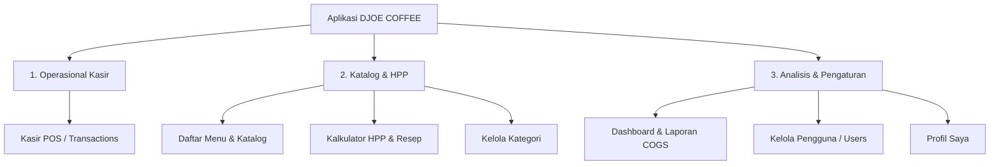

# ☕ DJOE COFFEE - System Workflow & Architecture Documentation

Dokumen ini berisi rekapitulasi lengkap dari seluruh alur kerja (workflow), arsitektur fitur, pemisahan tanggung jawab (separation of concerns), serta integrasi database pada sistem **DJOE COFFEE - Sistem Manajemen HPP & Kasir POS**.

---

## 🚀 1. Arsitektur & Pemisahan Fitur Utama (Core Modules)

Navigasi aplikasi dikelompokkan menjadi 3 kategori utama berbasis **Role-Based Access Control (RBAC)**:

---

## 📋 2. Rincian Fitur & Alur Kerja (Workflow Details)

### 🛒 Module 1: Operasional Kasir (`/pos`)
- **Pencarian & Filter Kategori**: Kasir dapat memfilter menu berdasarkan kategori (Minuman, Makanan, Snack) atau kolom pencarian instant.
- **Keranjang Belanja (Cart)**: Menghitung total belanjaan secara real-time.
- **Hitung Kembalian Otomatis**: Memasukkan uang tunai (`cash_received`) dan menghitung uang kembalian secara presisi.
- **Checkout & Simpan Transaksi**:
  1. Data transaksi dikirim ke API `POST /api/transactions`.
  2. Menyimpan header transaksi ke tabel Supabase `t_transactions`.
  3. Menyimpan item belanjaan beserta rincian nama, modal HPP (`unit_hpp`), harga jual (`unit_price`), dan quantity ke `t_transaction_items`.
- **Cetak Struk Thermal 58mm**:
  - **Direct Bluetooth Print**: Mencetak tanpa dialog browser via Bluetooth ESC/POS.
  - **Native Browser Print (Portal)**: Mencetak struk thermal 58mm dengan lebar area teks presisi `44mm` (margin `5mm` kanan-kiri), font monospace `7.5pt - 8pt bold`, tanpa URL footer browser.

---

### 📚 Module 2: Katalog & HPP (`/menu`, `/calculator`, `/categories`)

#### A. Daftar Menu (`/menu`)
- **Pusat Pendaftaran Produk**: Tempat resmi untuk menambah produk baru yang siap dijual di kasir.
- **Modal Tambah/Edit Menu Baru**:
  - Input nama produk, kategori, modal HPP, harga jual, dan margin profit.
  - **Upload Foto Menu**: Pratinjau gambar foto `w-24 h-24` muncul setelah file dipilih (tanpa grey box placeholder).
  - Menyimpan foto WebP/JPG ke Supabase storage / local uploads.
  - **Instant State Sync**: Begitu menu disimpan, daftar menu frontend dan POS kasir langsung ter-update tanpa reload.
- **Export Katalog Pelanggan**: Mencetak katalog daftar harga menu untuk meja pelanggan.

#### B. Kalkulator & Simulator HPP Resep (`/calculator`)
- **Murni Alat Simulasi Interaktif**: Berfungsi murni untuk meracik resep & menguji batas margin profit target per porsi.
- **Bahan Baku & Overhead**: Memasukkan takaran gram/ml bahan baku dan biaya kemasan/cup.
- **Export Laporan HPP**: Tombol khusus untuk mencetak Laporan HPP Internal toko.

#### C. Kelola Kategori (`/categories`)
- Menambah, mengubah, dan menghapus kategori menu toko.

---

### 📊 Module 3: Analisis & Pengaturan (`/dashboard`, `/users`, `/profile`)

#### A. Dashboard Real-Time COGS & Net Profit (`/dashboard`)
- **Real-Time Database Driven**: Data 100% dibaca langsung dari transaksi Supabase `t_transactions` & `t_transaction_items`.
- **KPI Card Metrics**:
  1. **Omset Penjualan Kotor (Gross Revenue)**: Total nilai penjualan kasir.
  2. **Total COGS (HPP Terjual)**: $\sum (\text{Qty Terjual} \times \text{Modal HPP Unit})$. Menghitung modal bahan baku yang terealisasi dari produk yang sukses terjual.
  3. **Laba Bersih (Net Profit)**: $\text{Omset Kotor} - \text{Total COGS}$.
  4. **Rata-rata Margin Profit Katalog**.
- **Filter Tanggal Laporan (Instant Auto-Trigger)**:
  - Presets: **7 Hari**, **30 Hari**, **90 Hari**, **Semua**.
  - Custom Date Range: *Start Date* & *End Date* (langsung memfilter secara otomatis begitu tanggal dipilih).
- **Grafik Tren Penjualan & Profit Harian**:
  - Menyusun timeline harian 7 hari penuh (Senin s/d Minggu).
  - **Logic Heights**: Jika bernilai `0`, batang murni 0% (tidak menonjol).
  - **Hover Tooltip**: Floating popover presisi di atas masing-masing batang grafik yang di-hover.

#### B. Kelola Pengguna (`/users`)
- Pengelolaan akun kasir & admin.
- Dilengkapi dengan upload foto avatar profile pengguna.

#### C. Profil Saya (`/profile`)
- Pengaturan identitas dan foto avatar akun pengguna yang sedang login.

---

## 🔒 3. Dynamic Navigation Bar (RBAC System)

Di [SidebarNav.tsx](file:///c:/Users/Omen/Documents/Hanif/kedai-kopi/kedai-kopi-hpp/app/components/SidebarNav.tsx):
- Judul kelompok navigasi (*OPERASIONAL KASIR*, *KATALOG & HPP*, *ANALISIS & PENGATURAN*) dikondisikan secara dinamis.
- Jika suatu Role (misal: *CASHIER*) tidak memiliki izin ke submenu di bawah kelompok tersebut, maka **JUDUL KATEGORI AKAN OTOMATIS DISEMBUNYIKAN**.

---

## ⚙️ 4. Ringkasan Skema Database Supabase

1. **`m_menus`**: `id`, `name`, `category_name`, `hpp`, `selling_price`, `margin_percent`, `image_url`, `created_by`, `created_at`.
2. **`t_transactions`**: `id`, `transaction_no`, `total_amount`, `cash_received`, `change_amount`, `payment_method`, `user_id`, `cashier_name`, `created_at`.
3. **`t_transaction_items`**: `id`, `transaction_id`, `menu_name`, `unit_hpp`, `unit_price`, `quantity`, `subtotal`.
4. **`m_users`**: `id`, `name`, `email`, `role`, `permissions`, `avatar_url`.
